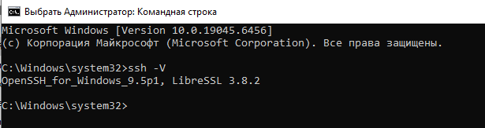
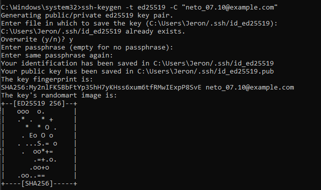
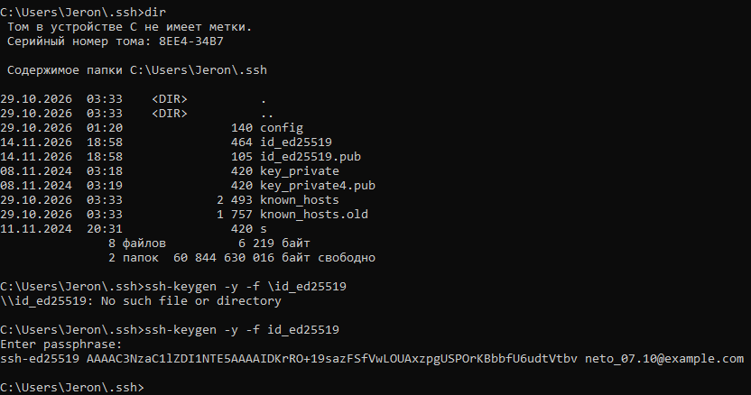
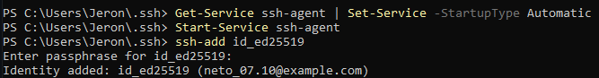
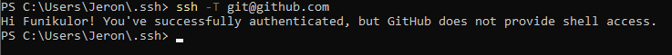
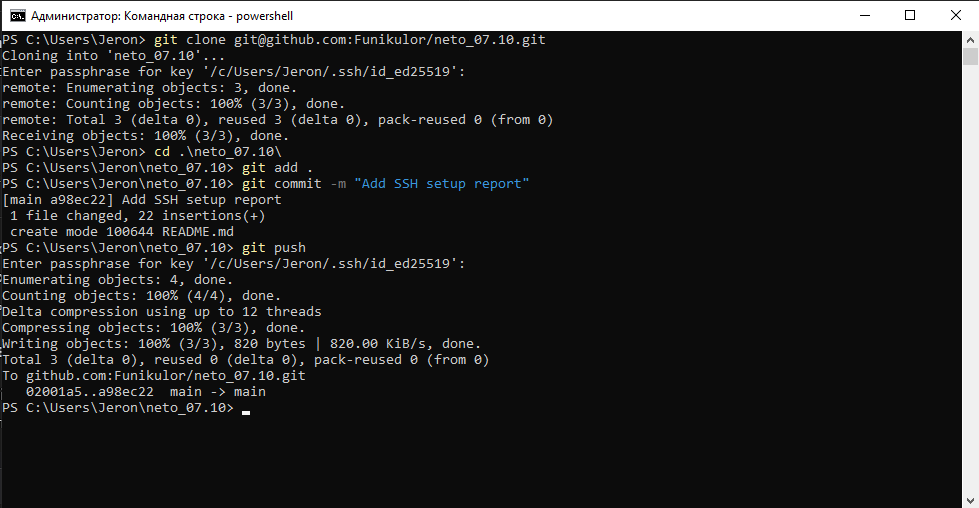

# Настройка SSH-доступа к GitHub (Windows 10)

## 1. SSH-клиент и генерация ключей

- Проверка: `ssh -V` → OpenSSH_for_Windows_9.x 
- Генерация: `ssh-keygen -t ed25519 -C "email"` 
- Passphrase установлена (подтверждение: ssh-keygen -y запрашивает пароль)
  

## 2. Публичный ключ добавлен в GitHub

## 3. Проверка подключения

`ssh -T git@github.com` → Hi USERNAME! You've successfully authenticated...

## 4. Работа с репозиторием по SSH

git clone / commit / push — выполнены без ввода пароля

